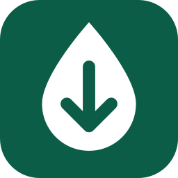

<p align="center"></p>

<h1 align="center">LitroLow</h1>

App Android nativa para encontrar la gasolina más barata de España con los precios oficiales del Ministerio. Compara miles de gasolineras, incluidas las low cost, muestra las cercanas en un mapa y avisa cuando un precio baja del máximo que elijas.

## Capturas

| Lista | Detalle | Mapa | Alertas |
|-------|---------|------|---------|
| `[captura: lista]` | `[captura: detalle]` | `[captura: mapa]` | `[captura: alertas]` |

## Funcionalidades

- **Lista de gasolineras** con los precios de Gasolina 95, Gasolina 98, Diésel y Diésel Premium, y un distintivo con la inicial y el color de cada marca para reconocerla de un vistazo.
- **Ahorro en euros**: al buscar una localidad o provincia, la cabecera muestra la más barata de esa zona y lo que ahorras frente a su media, en euros por repostaje, según los litros que sueles echar (de 1 a 200, se cambian desde el icono del surtidor de la barra superior). Si eliges una marca, también la compara con la más barata de todas. Cada ficha indica lo que ahorras o pagas de más frente a la media de su provincia. Las calles con ese nombre en otra provincia aparecen en la lista, pero no se comparan.
- **Semáforo de precios**: verde, ámbar o rojo según lo barato que es cada precio en su zona, también en el mapa y en el detalle.
- **Acciones directas**: desde la lista puedes marcar una favorita o crear una alerta sin abrir la gasolinera.
- **Filtros** por marca (sacadas de los datos reales) y por combustible, con orden de menor a mayor precio.
- **Búsqueda** por localidad, dirección o marca, sin distinguir tildes ni mayúsculas.
- **Mapa con OpenStreetMap**: muestra las gasolineras a menos de 10 km con su precio sobre el mapa y destaca la más barata. Funciona con tu ubicación o escribiendo una dirección, así que el permiso de ubicación es opcional.
- **Historial de precios** de cada gasolinera en una gráfica.
- **Alertas de precio**: eliges gasolinera, combustible y precio máximo, y recibes una notificación cuando se cumple. Los precios se comprueban cada hora aproximadamente aunque la app esté cerrada. Cada alerta indica su precio actual y si está cumplida o cuánto le falta. Puedes tener varias alertas por gasolinera, editarlas y borrarlas; la app rechaza las repetidas y los precios superiores a 10 €, que suelen ser erratas.
- **Favoritas** guardadas en el móvil, que se quitan con un toque desde su propia lista.
- **Detalle** con dirección, horario, precios y botón para abrir la ruta en la app de mapas.
- **Estados claros** de carga, error (sin internet o fallo de la API) y lista vacía. Si falla la red, se muestran los últimos datos guardados.
- **Tema oscuro por defecto** y tema claro a un toque; la elección se recuerda.

## Tecnologías

| Área | Tecnología |
|------|------------|
| Lenguaje | Kotlin, corrutinas y Flow |
| Interfaz | Jetpack Compose y Material 3 |
| Navegación | Navigation Compose |
| Red | Retrofit, OkHttp y Kotlinx Serialization |
| Base de datos | Room |
| Tareas en segundo plano | WorkManager |
| Mapa | osmdroid (OpenStreetMap, sin clave de API) |
| Gráficas | Vico |
| Arranque | API SplashScreen |
| Tests | JUnit y kotlinx-coroutines-test |

Requiere Android 8.0 (API 26) o superior y está compilada para la API 37. Solo funciona en vertical.

## Arquitectura

LitroLow usa **MVVM** (Modelo-Vista-ViewModel), que separa la app en tres responsabilidades:

```
Vista (Compose)  --acciones-->  ViewModel  --pide datos-->  Repositorio  -->  API / Room
                 <--StateFlow--            <-----Flow-----
```

- **Modelo** (`data/`): obtiene y guarda los datos.
- **ViewModel** (`ui/*/*ViewModel.kt`): prepara el estado de cada pantalla (cargando, datos o error) y lo expone en un `StateFlow`.
- **Vista** (`ui/*/*Screen.kt`): dibuja ese estado y comunica lo que hace el usuario. No contiene lógica de negocio.

**Por qué MVVM:**

- **Se puede probar:** los ViewModels no dependen de la interfaz, así que sus tests se ejecutan sin móvil ni emulador.
- **Sobrevive a los cambios:** el estado vive en el ViewModel y no se pierde al recrearse la pantalla.
- **Se puede mantener:** cambiar el diseño no afecta a las reglas de la app, y al revés.

**Room es la única fuente de verdad.** Las pantallas siempre leen de la base de datos y la red solo la actualiza. Por eso la app sigue mostrando datos sin internet, y una respuesta vacía de la API nunca borra lo guardado.

### Decisiones de diseño

- **Pocos datos móviles:** la descarga completa pesa unos 12 MB, así que solo se repite si los datos tienen más de 30 minutos, que es lo que tarda la API en actualizarse. Las alertas descargan solo la provincia necesaria, unos 200 KB.
- **Historial compacto:** se guarda un punto cada vez que una consulta detecta un precio distinto, y se conservan 90 días. Repetir precios iguales no aportaría nada a la gráfica y llenaría la base de datos.
- **Sin inyección de dependencias:** con tan pocas piezas, `LitroLowApplication` las crea a mano y se evita una librería más.

## Estructura de carpetas

```
app/src/main/java/com/peter1323/litrolow/
├── LitroLowApplication.kt     Crea y comparte las dependencias
├── MainActivity.kt            Splash y punto de entrada de la interfaz
├── data/
│   ├── api/                   Retrofit, formato de la API y conversión de precios
│   ├── db/                    Base de datos Room y DAO
│   ├── model/                 Modelos, filtros, distancias y comparación de precios
│   └── repository/            Gasolineras, alertas, ubicación, tema y depósito
├── ui/
│   ├── alerts/                Pantalla y ViewModel de alertas
│   ├── components/            Elementos compartidos entre pantallas
│   ├── detail/                Detalle, gráfica y creación de alertas
│   ├── favorites/             Pantalla y ViewModel de favoritas
│   ├── map/                   Mapa y su ViewModel
│   ├── navigation/            Barras y navegación
│   ├── stations/              Lista, filtros y su ViewModel
│   └── theme/                 Paleta de colores
└── worker/                    Comprobación periódica y notificaciones

app/src/test/                  Tests de ViewModels y conversión de precios
```

## Instalación

### Instalar la APK

1. Descarga la APK desde [Releases](https://github.com/peter1323/LitroLow/releases/latest):

   | Archivo | Para qué dispositivo |
   |---------|----------------------|
   | `universal` | Cualquiera. Es la opción recomendada si tienes dudas |
   | `arm64-v8a` | La mayoría de móviles actuales |
   | `armeabi-v7a` | Móviles antiguos de 32 bits |

2. Ábrela en el móvil y permite la instalación desde esa fuente si Android lo pide.

### Compilar con Android Studio

1. Clona el repositorio:
   ```bash
   git clone https://github.com/peter1323/LitroLow.git
   ```
2. Abre la carpeta en Android Studio y espera a que termine la sincronización de Gradle.
3. Pulsa **Run**. No hace falta ninguna clave de API.

También se puede hacer desde la terminal:

```bash
./gradlew assembleRelease
./gradlew testDebugUnitTest
```

Las tres APK quedan en `app/build/outputs/apk/release/`. Se firman con la clave de depuración para poder instalarlas sin configurar nada; para publicarla en Google Play habría que usar una clave propia.

## Fuente de los datos

- **Precios:** [API REST de precios de carburantes](https://sedeaplicaciones.minetur.gob.es/ServiciosRESTCarburantes/PreciosCarburantes/EstacionesTerrestres/) del Ministerio, pública, gratuita y sin clave. Se actualiza cada media hora.
- **Mapas:** © colaboradores de [OpenStreetMap](https://www.openstreetmap.org/copyright).

Los nombres de las marcas son los que publica el Ministerio. LitroLow no tiene relación con el Ministerio ni con ninguna de estas marcas.

## Autoría

Copyright © 2026 peter1323. Todos los derechos reservados. No se permite copiar, modificar ni redistribuir esta app o su código sin permiso del autor; consulta el archivo [LICENSE](LICENSE).
